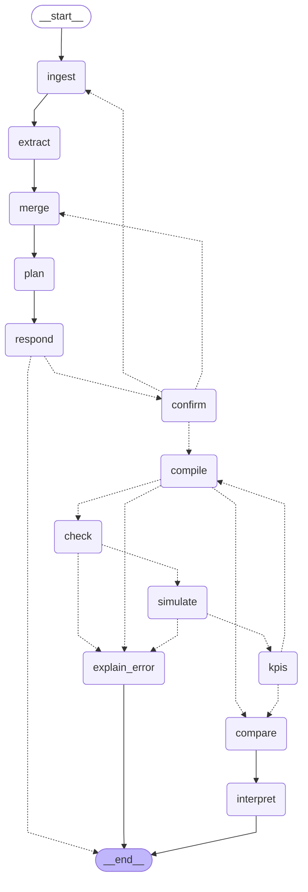

# Workflow

The LangGraph graph (`llmtrano.workflow.graph`), exported with `graph.get_graph().draw_mermaid()`.
Regenerate after every change with `uv run python -m llmtrano.workflow.graph`; `tests/test_workflow.py` fails
when this file is stale.

